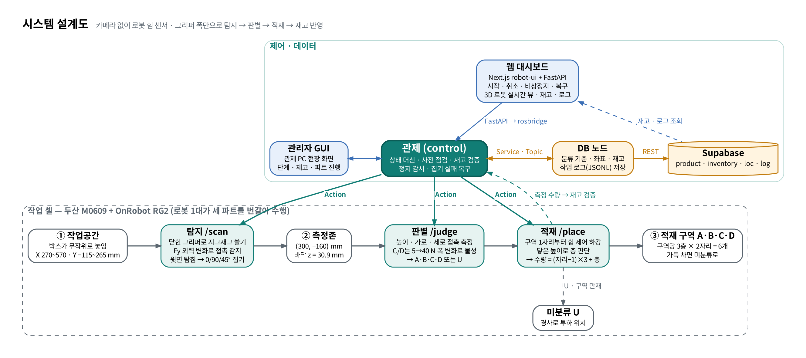
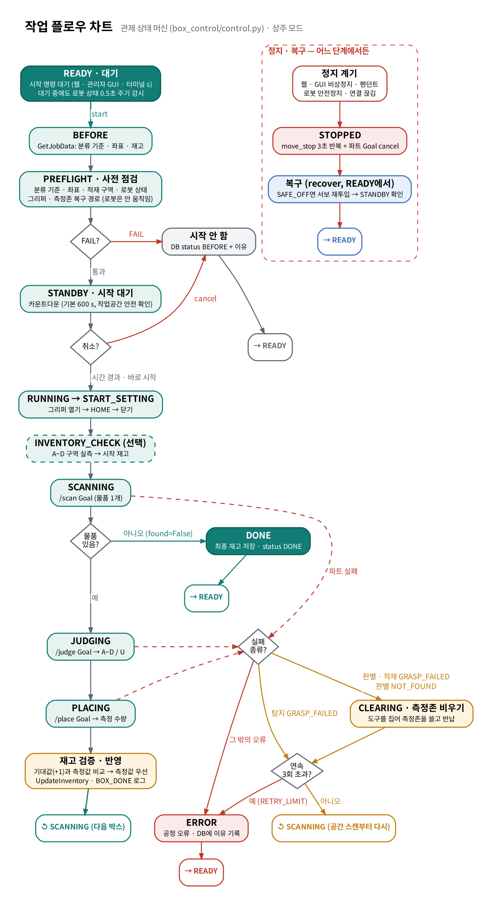
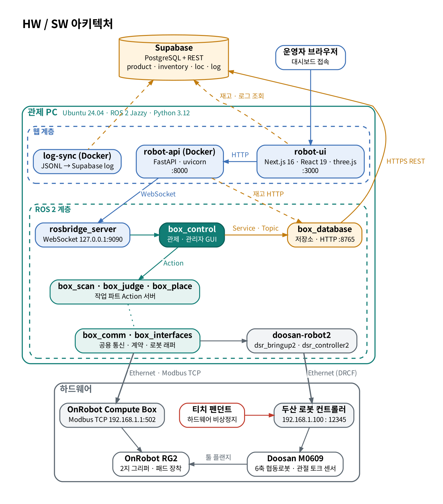
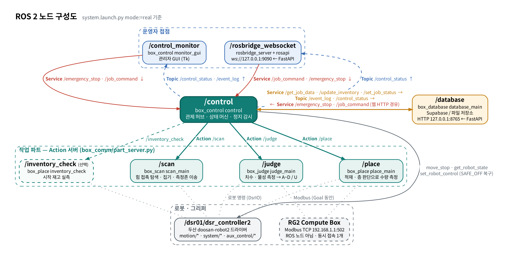
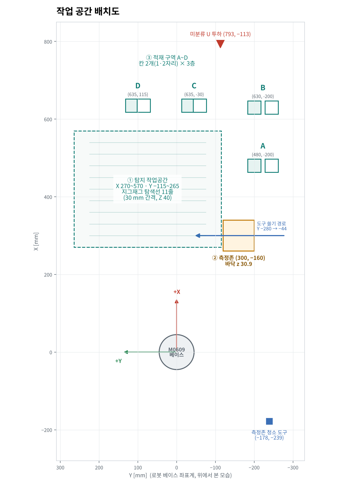

# 📦 소형 박스 자동 분류 및 재고 관리 시스템

> **조 이름:** B조 1팀 · ROKEY 10기 협동-1 프로젝트<br>
> **팀원:** 최은정 (관제·통합, 팀장) · 김창균 (탐지) · 송현석 (판별) · 정수현 (적재) · 이승재 (DB·UI)

두산 협동로봇 **M0609**와 **OnRobot RG2** 그리퍼만으로 소형 박스를 찾아 집고, 크기와 물성을 재서 A/B/C/D로 분류한 뒤 구역별로 쌓으면서 재고를 관리하는 ROS 2 자동화 시스템입니다.
**카메라·비전·추가 센서 없이** 로봇의 관절 토크 기반 외력과 그리퍼 폭만으로 탐지·측정·적재 수량 확인을 모두 처리합니다.

| 핵심 | 내용 |
| --- | --- |
| 🔍 **비전 없는 탐지** | 닫은 그리퍼로 작업공간을 지그재그로 쓸며 외력(Fy) 변화로 박스 측면 접촉을 감지하고, 윗면을 탐침해 집습니다. |
| 📏 **접촉 측정 판별** | 높이·가로·세로를 접촉과 그리퍼 폭으로 재고, 치수가 같은 C/D는 쥐는 힘에 따른 폭 변화(물성)로 구분합니다. 어디에도 맞지 않으면 미분류 **U**. |
| 🧱 **적재 = 재고 측정** | 박스를 쥔 채 구역 1자리부터 힘 제어로 내려가 닿은 높이로 층을 판단합니다. 놓은 위치가 곧 실제 수량입니다. |
| 🛡️ **안전·복구** | 사전 점검, 시작 카운트다운, 비상정지·로봇 안전정지·파트 노드 종료 감지, 집기 실패 시 측정존 청소 후 재스캔, SAFE_OFF 원격 복구. |
| 🖥️ **웹 대시보드** | 시작·취소·바로 시작·비상정지·복구, 실시간 3D 로봇 뷰(M0609 + RG2), 구역별 재고, 작업 로그. |

<!-- TODO: 시연 영상 링크 -->

### 목차

1. [시스템 설계 및 플로우 차트](#sec-design) — 시스템 설계도 · 플로우 차트 · HW/SW 아키텍처 · 노드 구성도 · 작업 공간 배치도
2. [운영체제 환경](#sec-os)
3. [사용 장비 목록](#sec-hw)
4. [의존성](#sec-deps)
5. [실행 순서](#sec-usage)
6. [주요 기능 상세](#sec-features)
7. [인터페이스](#sec-interfaces)
8. [패키지 구성](#sec-packages)
9. [테스트와 시뮬레이션](#sec-test)
10. [팀 구성과 문서](#sec-team)

---

<a id="sec-design"></a>

## 1. 🎨 시스템 설계 및 플로우 차트

### 1-1. 시스템 설계도 (System Design)

<p align="center">
  
</p>

* 로봇 한 대가 **탐지 → 판별 → 적재** 세 공정을 번갈아 수행합니다. 각 공정은 독립 ROS 2 노드(Action 서버)이고, **관제(control)** 가 유일한 허브로 순서를 지휘합니다.
* 파트끼리는 직접 통신하지 않으며 DB와 UI도 모릅니다. 파트 로그는 Action Feedback으로 관제에 올라가고, 관제가 `/event_log`로 DB에 넘깁니다.
* 분류 기준(물품 A~D 치수), 고정 좌표(측정존·적재 구역)와 재고는 **DB가 기준**입니다. 관제가 작업 시작 때 받아 모든 Goal에 실어 보냅니다.

### 1-2. 플로우 차트 (Flow Chart)

<p align="center">
  
</p>

* 관제는 **상주 모드**로 실행되어 `READY`에서 시작 명령을 기다리고, 작업 한 번이 끝나면(DONE·ERROR·취소) 다시 `READY`로 돌아옵니다.
* 박스 하나는 `SCANNING → JUDGING → PLACING → 재고 검증`을 거치며, 탐지가 `found=False`(물품 없음)를 돌려주면 작업을 완료합니다.
* 집기 실패는 작업을 바로 끝내지 않습니다. 판별·적재 중 실패면 관제가 도구로 측정존을 쓸고, 공간 스캔부터 다시 시도합니다(연속 3회까지).
* 비상정지·로봇 이상은 **어느 단계에서든** 즉시 `move_stop` + 파트 Goal 취소로 이어집니다.

### 1-3. HW / SW 아키텍처

<p align="center">
  
</p>

* 관제 PC 한 대에서 ROS 2 노드, rosbridge, FastAPI(Docker), Next.js 대시보드가 모두 실행됩니다.
* 로봇 컨트롤러는 두산 드라이버(DRCF)로, RG2 그리퍼는 Compute Box에 **Modbus TCP로 직접** 접속합니다. Compute Box는 동시 접속이 1개라 OnRobot ROS 드라이버는 끄고 파트가 Goal 동안만 접속합니다.
* 브라우저는 ROS에 직접 붙지 않습니다. 명령은 `UI → FastAPI → rosbridge → 관제`, 재고·로그 조회는 Supabase에서 읽습니다. 서비스 키는 서버(FastAPI·DB 노드)에만 있습니다.

### 1-4. 노드 구성도 (ROS 2 Node Graph)

<p align="center">
  
</p>

| 통신 | 이름 | 방향 | 용도 |
| --- | --- | --- | --- |
| **Action** | `/scan` `/judge` `/place` `/inventory_check` | 관제 → 파트 | 로봇 동작이 길고 진행(Feedback)·결과가 필요한 공정 |
| **Service** | `/get_job_data` `/update_inventory` `/set_job_status` | 관제 → DB | 작업 데이터 수신, 재고·작업 상태 기록 |
| **Service** | `/emergency_stop` `/job_command` | DB·GUI·rosbridge → 관제 | 비상정지, 시작·취소·바로 시작·복구 |
| **Topic** | `/event_log` (`LogEvent`) | 관제 → DB·GUI | 이벤트 로그. 보내기만 하고 응답을 기다리지 않음 |
| **Topic** | `/control_status` (`std_msgs/String` JSON) | 관제 → DB·GUI·웹 | 단계·재고·로봇 상태·남은 시간. 2초마다 재발행 |
| 두산 서비스 | `motion/move_stop` `system/get_robot_state` `system/set_robot_control` | 관제 → 로봇 | 정지, 상태 감시(0.5초), SAFE_OFF 복구 |

### 1-5. 작업 공간 배치도

<p align="center">
  
</p>

* 좌표는 로봇 베이스 기준(mm)이며 실제 값은 DB(`loc`)에서 읽습니다. 그림의 값은 기본값입니다.
* 적재 구역은 분류별로 **2자리 × 3층 = 6개**를 쌓습니다. 다음 자리는 A·B가 −y 45 mm, C·D가 −y 30 mm 옆입니다.
* 미분류 U 투하 위치와 측정존 청소 도구 경로는 DB가 아니라 각각 적재 설정(`place_config.json`)과 관제 복구 설정(`recovery.TOOL_SWEEP`)에 있습니다.

---

<a id="sec-os"></a>

## 2. 🖥️ 운영체제 환경 (OS Environment)

이 프로젝트는 다음 환경에서 개발하고 실물 로봇으로 검증했습니다.

| 항목 | 버전 |
| --- | --- |
| **OS** | Ubuntu 24.04 LTS |
| **ROS** | ROS 2 Jazzy |
| **Language** | Python 3.12 (ROS 노드·FastAPI), TypeScript (Next.js 대시보드) |
| **Robot Driver** | doosan-robot2 (Jazzy), `m0609_rg2_bringup` |
| **Web** | Node.js 20+, Docker (Docker Desktop `desktop-linux` 컨텍스트) |
| **DB** | Supabase (PostgreSQL + REST) 또는 로컬 JSON 파일 저장소 |
| **IDE** | VS Code |

---

<a id="sec-hw"></a>

## 3. 🛠️ 사용 장비 목록 (Hardware List)

| 장비명 (Model) | 수량 | 비고 |
| :---: | :---: | :--- |
| Doosan Robotics **M0609** | 1 | 6축 협동로봇. 관절 토크 센서로 외력 측정. 컨트롤러 `192.168.1.100:12345` |
| 두산 로봇 컨트롤러 + 티치 펜던트 | 1 | 하드웨어 비상정지, SAFE_OFF 원인 확인 |
| OnRobot **RG2** 그리퍼 | 1 | 패드 장착. TCP `GripperDA_v1` (z 208.4 mm), 툴 무게 1.53 kg |
| OnRobot **Compute Box** | 1 | RG2 Modbus TCP `192.168.1.1:502` |
| 관제 PC (노트북) | 1 | Ubuntu 24.04. ROS 2 · Docker · 웹 대시보드 실행, 유선 LAN으로 로봇·Compute Box 연결 |
| 측정존 | 1 | 판별용 평판. 중심 (300, −160) mm, 바닥 z 30.9 mm |
| 적재 구역 A·B·C·D | 4 | 구역당 2자리 × 3층 |
| 미분류 경사로 | 1 | U 투하 위치 |
| 측정존 청소 도구 | 1 | 집기 실패 뒤 관제가 집어 측정존을 쓸고 반납 |
| 분류 대상 박스 | – | A 알루미늄 묶음 60×40×20 · B 젠가 묶음 75×29×25 · C 알루미늄 묶음 50×40×20 · D 지우개 50×40×20 (mm, 기본값) |

> 치수·무게 기준값은 DB `product` 테이블이 기준이며, 위 값은 파일 저장소 모드의 기본값입니다.

---

<a id="sec-deps"></a>

## 4. 📦 의존성 (Dependencies)

### ROS 2 / 시스템

```bash
sudo apt install ros-jazzy-rosbridge-suite python3-pymodbus python3-tk
```

* **doosan-robot2** (Jazzy): `dsr_bringup2`, `dsr_controller2`, `dsr_msgs2`, `DSR_ROBOT2` — 같은 워크스페이스에 먼저 빌드
* **m0609_rg2_bringup**: 수업 bringup 패키지 (원본은 수정하지 않고 `box_bringup/robot.launch.py`에서 OnRobot 드라이버·RViz만 끄고 포함)
* `rosbridge_server`, `rosapi`: 웹 API 연결 (`box_bringup/package.xml`에 선언)
* `python3-pymodbus`: RG2 Modbus (`box_comm/gripper.py`)
* `python3-tk`: 관리자 모니터 GUI
* Supabase 연동은 Python 표준 `urllib`만 사용하므로 별도 SDK가 필요 없습니다.

### 웹 API (`box_ui/robot-api`, Docker 이미지 `python:3.12`)

| 패키지 | 버전 |
| --- | --- |
| fastapi | 0.165.0 |
| pydantic | 2.14.3 |
| uvicorn | 0.54.0 |
| websocket-client | 1.9.2 |

### 웹 UI (`box_ui/robot-ui`)

| 패키지 | 버전 |
| --- | --- |
| next | 16.4.6 |
| react / react-dom | 19.3.0 |
| three | ^0.187.0 (M0609·RG2 URDF 3D 뷰) |
| @supabase/supabase-js | ^2.119.0 |
| tailwindcss | 4.3.3 |

---

<a id="sec-usage"></a>

## 5. ▶️ 실행 순서 (Usage Guide)

아래는 실제 로봇 기준 전체 순서입니다. 워크스페이스는 `~/ws_cobot_pjt/ws_dsr`, 저장소는 그 `src/box_project`에 있다고 가정합니다.
로봇 없이 확인하려면 [9. 테스트와 시뮬레이션](#sec-test)을 보세요.

### Step 1. 빌드 — 두산 드라이버 위에 이 프로젝트를 overlay로 빌드합니다.

```bash
cd ~/ws_cobot_pjt/ws_dsr/src
git clone https://github.com/CHOI-510/rokey10_b1_1st_project.git box_project

source /opt/ros/jazzy/setup.bash
source ~/ws_cobot_pjt/ws_dsr/install/setup.bash        # doosan-robot2가 빌드된 워크스페이스
cd ~/ws_cobot_pjt/ws_dsr/src/box_project
colcon build --symlink-install                          # box_ui는 COLCON_IGNORE로 제외됨
source install/local_setup.bash
```

> 새 터미널마다 두산 워크스페이스 → 이 프로젝트 `install/local_setup.bash` 순서로 source합니다.
> `bash scripts/run_real_robot.sh --check`로 패키지가 이 프로젝트 install에서 실행되는지 확인할 수 있습니다(로봇은 움직이지 않음).

### Step 2. 환경 설정 — 최초 1회

`box_ui/robot-ui/.env.local`을 만듭니다. (Git에 올리지 않습니다. 서비스 키는 서버만 사용합니다.)

```bash
NEXT_PUBLIC_SUPABASE_URL=https://<project>.supabase.co
NEXT_PUBLIC_SUPABASE_PUBLISHABLE_KEY=<publishable key>     # 브라우저 읽기 전용
NEXT_PUBLIC_ROBOT_API_URL=http://localhost:8000
SUPABASE_SERVICE_KEY=<service key>                         # DB 노드·FastAPI·log-sync만 사용
```

Supabase SQL Editor에서 한 번 실행합니다.

| SQL | 내용 |
| --- | --- |
| `sql/log_inventory_trigger.sql` | `log` INSERT 시 메시지를 파싱해 `inventory`를 절대값으로 갱신하는 트리거 |
| `sql/loc_inventory_calibration.sql` | `loc.inventory_calibration`에 시작 재고 실측용 교정값 저장 |
| `sql/repair_inventory_log_positions.sql` | (필요 시) 트리거의 구역별 watermark 테이블 복구 |

### Step 3. 로봇 준비 — 전원·네트워크·작업공간을 확인합니다.

* 로봇 컨트롤러(`192.168.1.100`)와 Compute Box(`192.168.1.1`)가 관제 PC와 같은 네트워크에 있는지 확인합니다.
* 펜던트를 **자동 모드**로 두고, 측정존·적재 구역·미분류 경사로·청소 도구가 제자리에 있는지 확인합니다.

### Step 4. 전체 시스템 실행 — 로봇 bringup부터 관제까지 launch 하나로 띄웁니다.

```bash
ros2 launch box_bringup system.launch.py mode:=real db_store:=supabase
```

| 인자 | 기본값 | 설명 |
| --- | --- | --- |
| `mode` | `virtual` | `real` 실제 로봇 / `virtual` 에뮬레이터 |
| `fake` | `false` | `true`면 로봇 없이 모든 파트를 fake로 |
| `bringup` | `true` | `false`면 두산 bringup을 따로 띄운 것을 사용 |
| `db_store` | `auto` | `supabase` / `file` / `auto`(키가 있으면 Supabase) |
| `inventory_check` | `false` | `true`면 시작 직후 A~D 구역을 실측해 시작 재고로 사용 |
| `start_delay` | `600.0` | 시작 카운트다운 [s] (시험 때 `30.0` 등) |
| `gui` / `rosbridge` / `rviz` | `true` / `true` / `false` | 관리자 GUI, 웹용 rosbridge(9090), RViz |

`mode`에 따라 실행 노드가 바뀝니다.

| mode | 로봇 bringup | 탐지 | 판별 | 적재 | 그리퍼 |
| --- | --- | --- | --- | --- | --- |
| `real` | 실제 `192.168.1.100` | `scan_main` | `judge_main` | `place_main` | Modbus |
| `virtual` | 에뮬레이터 `127.0.0.1` | `scan_main` + 가상 박스 | `fake_judge` | `place_main` + 가상 접촉 | fake |
| `fake:=true` | 없음 | `fake_scan` | `fake_judge` | `fake_place` | fake |

> 파일 저장소로 운용할 때는 `bash scripts/run_real_robot.sh`가 설치 경로를 확인한 뒤
> `mode:=real inventory_check:=true start_delay:=30.0 db_store:=file`로 실행합니다. 이때 Supabase 반영은 Step 5의 `log-sync`가 맡습니다.

### Step 5. 웹 API 실행 — FastAPI와 로그 전송 컨테이너를 띄웁니다.

```bash
cd ~/ws_cobot_pjt/ws_dsr/src/box_project/box_ui/robot-api
docker --context desktop-linux compose up -d --build
curl http://localhost:8000/health
curl http://localhost:8000/robot/status          # mode가 rosbridge, 관제 단계 READY인지 확인
```

### Step 6. 웹 대시보드 실행

```bash
cd ~/ws_cobot_pjt/ws_dsr/src/box_project/box_ui/robot-ui
npm ci                      # 최초 1회
npm run build && npm start  # 시연용 (개발 중에는 npm run dev)
```

브라우저에서 <http://localhost:3000/dashboard>를 엽니다.

### Step 7. 작업 시작

1. 대시보드(또는 관리자 GUI)의 **시작**을 누르고, 안전 확인 팝업에서 재고를 확인한 뒤 시작합니다.
2. 관제가 사전 점검을 통과하면 카운트다운이 시작됩니다. 작업공간에 사람·장애물이 없는지 확인합니다. **취소** 또는 **바로 시작**을 누를 수 있습니다.
3. 로봇이 그리퍼 열기 → HOME → 닫기 후 탐지를 시작하고, 물품이 없을 때까지 반복합니다.
4. 멈춰야 하면 **비상정지**(웹·관리자 GUI·펜던트). 정지 원인을 현장에서 해결한 뒤 대기 상태에서 **복구**를 누르면, 로봇이 SAFE_OFF일 때 서보를 다시 켜고 정지 상태를 해제합니다.
5. 전체 종료는 launch 터미널에서 `Ctrl+C` 한 번입니다.

---

<a id="sec-features"></a>

## 6. ⚙️ 주요 기능 상세

### 6-1. 탐지 `/scan` — 비전 없는 박스 찾기 (`box_scan`)

* Goal 한 번에 **물품 1개**를 측정존에 옮기고 공통 WAYPOINT(측정존 위 Z 160)로 돌아옵니다.
* 닫은 그리퍼를 기울여 X 270~570 mm 범위의 11줄(30 mm 간격)을 Y 265 ↔ −115로 지그재그 탐색하고, 이어서 X 방향 확인 탐색을 합니다. 경로별 보정표 대비 외력 변화가 한계(Y 탐색 2 N, X 확인 3 N)를 넘으면 접촉으로 판단합니다.
* 접촉점 앞 반원에서 윗면 높이를 탐침하고, **윗면 − 15 mm** 높이에서 0° → 90° → 45° 순으로 최대 3번 집습니다. 겹친 박스는 맨 위만 잡습니다.
* 탐색 커서를 Goal 사이에 유지해, 다음 Goal은 마지막 접촉 위치부터 이어서 탐색합니다. 전체를 다 훑으면 `found=False`를 돌려줍니다.

### 6-2. 판별 `/judge` — 접촉 측정과 위상 정렬 (`box_judge`)

* **높이**: 닫힌 핑거 끝으로 하강해 Fz 접촉(대략 → 정밀 2단계)으로 측정합니다.
* **가로·세로**: 그리퍼로 잡아 폭을 측정합니다. 이때 sync 집기로 닫히는 동안 핑거 끝 높이를 유지하고, 다음 변은 J6를 돌려 측정합니다.
* **판정**: 세 길이를 크기순으로 기준과 비교합니다. 허용 오차는 높이 3 mm, 가로·세로 2.5 mm입니다. 후보가 여럿이면(C·D) 5 → 40 N 폭 변화로 **말랑/딱딱**을 가립니다(0.8 mm 이상이면 말랑 = D). 후보가 없으면 `U`입니다.
* **위상 정렬**: 가장 긴 변이 로봇 x, 두 번째 변이 y, 가장 짧은 변이 높이가 되도록 측정존 중앙에 놓습니다. 적재는 이 자세를 그대로 집습니다.
* 무게는 측정하지 않습니다(stage만 보고). 분류는 치수와 물성으로 합니다.

### 6-3. 적재 `/place` — 놓으면서 재고 측정 (`box_place`)

* 측정존에서 sync 집기(10 N으로 닫고 40 N으로 재조임)로 박스 아래쪽을 잡고, 0.5초 기다린 뒤 15 mm는 천천히 들어 올립니다.
* 구역 **1자리부터** 박스를 쥔 채 힘 제어로 내려가 닿은 높이로 층을 판단합니다. 3층 위에서 닿으면 다음 자리로 갑니다.
* 놓은 위치로 수량을 계산합니다: `수량 = (자리 − 1) × 3 + 층`. 관제는 기대값(+1)과 비교하고 **측정값을 우선** 반영합니다.
* 두 자리가 모두 차면 박스를 미분류 위치로 보내고 작업은 계속합니다(`ZONE_FULL`). `U`는 경사로에 놓기만 하고 관제가 +1로 집계합니다.
* (선택) `/inventory_check`: 시작 시 A~D 구역을 빈 그리퍼로 접촉해 시작 재고를 실측합니다. 교정값은 DB `loc.inventory_calibration`(또는 파일)에서 읽습니다.

### 6-4. 관제 — 허브·안전·복구 (`box_control`)

| 기능 | 내용 |
| --- | --- |
| 사전 점검 (PREFLIGHT) | 분류 기준, DB 좌표, 적재 구역, 로봇 상태(STANDBY·MOVING), RG2 Modbus 연결, 측정존 복구 경로. FAIL이면 시작하지 않고 로봇도 움직이지 않음 |
| 시작 대기 (STANDBY) | 기본 600초 카운트다운(작업공간 안전 확인). 웹·GUI에서 취소 / 바로 시작 |
| TCP·툴 자동 확인 | 각 파트 Goal 직전에 기본 TCP·툴을 조회하고 다르면 적용. 실패하면 `ROBOT_SETUP_FAILED` |
| 재고 검증 | 적재 측정값과 기대값 비교 → 측정값 우선 반영, 불일치는 `COUNT_MISMATCH` 경고 |
| 집기 실패 복구 | 판별·적재 실패면 `CLEARING`: 도구를 집어 측정존을 쓸고 반납 → 공간 스캔부터 다시. 연속 3회 초과면 `RETRY_LIMIT` |
| 정지 감시 | 비상정지 요청, 로봇 상태 이상(0.5초 주기), 연결 끊김(3초), 파트 노드 종료(`PART_DIED`), 진행 없음(선택) → `move_stop` 3초 반복 + 파트 Goal cancel |
| SAFE_OFF 복구 | READY에서 `recover` 명령 → SAFE_OFF면 `set_robot_control`로 서보 재투입, STANDBY 확인 후 정지 해제. 다른 안전 상태는 펜던트에서 처리 |
| 관제 오류 격리 | 관제 코드 예외도 로봇 정지 후 `ERROR : Control error`로 끝내고 READY로 복귀(프로세스는 유지) |

작업 결과는 DB `status`와 `reason`으로 남고, UI에는 `{status} : {reason}`로 표시됩니다.

| status | 의미 | 사람이 할 일 |
| --- | --- | --- |
| `BEFORE` | 작업 전 / 시작 안 함 | – |
| `RUNNING` | 작업 중 | – |
| `DONE` | 작업 완료 | – |
| `ERROR` | 공정 오류 (관제가 판단해 멈춤, 로봇은 정상) | 로그 확인 후 재시작 |
| `STOPPED` | 로봇이 물리적으로 멈춤 (비상정지·안전정지·연결 끊김) | 현장 확인 → 복구 |

### 6-5. DB와 웹 대시보드 (`box_database`, `box_ui`)

* **DB 노드**: 저장소는 Supabase 또는 파일 두 가지이고 함수 계약은 같습니다. Supabase 모드는 `product`(name, len, weight), `inventory`(loc_id, product_name, cnt), `loc`(id, coords, inventory_calibration), `log`를 사용합니다.
* **저장 실패 시 재시도**: 저장이 실패해도 작업은 멈추지 않습니다. 재고·상태를 모아 두었다가 다시 보냅니다(`DB_RETRY`).
* **로그**: `/event_log`는 `~/box_logs/{job_id}.jsonl`에 원본으로 남습니다. 키워드가 들어간 줄만 Supabase `log`에 올라가고(LogSync), 트리거가 그 메시지에서 재고를 절대값으로 갱신합니다.
* **HTTP 창구** (`127.0.0.1:8765`): `POST /estop /start /cancel /recover /inventory`, `GET /inventory /health /state`
* **FastAPI** (`:8000`):
  * `GET /health`, `/robot/status`, `/robot/telemetry`(읽기 전용 관절각·TCP), `/robot/inventory`, `/robot/inventory/calibration`, `/robot/locations`
  * `POST /robot/start`, `/start_now`, `/stop`, `/cancel`, `/recover`, `/inventory`
* **대시보드**: 작업 상태·카운트다운·버튼, 구역별 재고(1초 주기 조회), 작업 로그 요약, URDF 기반 M0609 + RG2 **실시간 3D 뷰**(텔레메트리 0.1초, 적재 박스 표시)
* **관리자 GUI** (`monitor_gui`, Tk): 관제 PC용 화면입니다. 단계, 재고 A~D·U, 파트별 Goal 진행, 로봇 상태·알람, 이벤트 로그를 보여 주고 시작·바로 시작·비상정지 버튼이 있습니다.

<details>
<summary><b>로봇 설정 (TCP·툴) 자동 적용 상세</b></summary>

TCP와 툴은 컨트롤러에 하나만 걸리는 전역 설정이라, 앞 파트가 바꾼 값이 남거나 미등록이면 플랜지 기준으로 움직여 TCP 오프셋(208.4 mm)만큼 더 내려갑니다. `box_comm/robot.py`가 **각 파트 Goal의 알고리즘 실행 직전에** 확인·적용합니다.

| 항목 | 값 (`box_comm/common.py`) |
| --- | --- |
| TCP | `GripperDA_v1`, `[0, 0, 208.4, 0, 0, 0]` |
| 툴 | `Tool Weight`, 1.530 kg, 무게중심 `[13.52, 79.74, 0.12]` mm |

1. 현재 이름 조회 → 기본값이면 끝
2. 다르면 적용 → 재조회
3. 그래도 다르면 수동 모드 → 등록 → 적용 → 자동 모드 → 확인 (자동 모드 복귀는 실패해도 항상 시도)
4. 최종 실패면 알고리즘을 실행하지 않고 `ROBOT_SETUP_FAILED`

파트 파라미터 `robot_setup`: `auto`(서비스 없으면 건너뜀, 기본) / `on`(실패면 Goal 실패, 실물 권장) / `off`

</details>

<details>
<summary><b>그리퍼 (RG2 Modbus) 상세</b></summary>

* `box_comm/gripper.py`가 Compute Box `192.168.1.1:502`에 접속합니다. 디지털 출력(DO) 방식은 쓰지 않습니다.
* **잡힘 판정** (`check_grip`/`holding`): 잡힘 비트 + 패드 간격 17~80 mm(탐지·적재만) + 들어 올린 뒤 폭 변화 3 mm 이내
* **쥐는 힘** 40 N. sync 집기는 10 N으로 닫고 적재는 40 N으로 재조임합니다. 판별 폭 측정은 10 N 기준입니다.
* **sync 집기** (`box_comm/sync_grip.py`, `common.SYNC_GRIP`): RG2는 벌릴수록 핑거 끝이 올라갑니다(열림↔닫힘 약 39 mm). 100 mm로 열고 핑거 끝을 바닥 + 2.6 mm에 둔 채, 닫히는 만큼 TCP를 올려 높이를 유지합니다. 바닥을 긁으면 `tip_above_floor_mm` 하나만 올리면 됩니다.
* 동시 접속 1개라 각 파트의 로봇 래퍼(`DsrIO`)가 그리퍼를 처음 쓸 때 접속하고 Goal이 끝나면 끊습니다. `system.launch.py`는 OnRobot 드라이버를 기본으로 끕니다(`gripper_driver:=false`).
* 에뮬레이터·fake: `BOX_GRIPPER=fake`(launch가 자동 설정). `BOX_FAKE_GRIP_FAILS=N`이면 처음 N번 집기 실패를 흉내 냅니다.

</details>

<details>
<summary><b>관제 파라미터</b> (<code>box_bringup/config/params.yaml</code>, launch)</summary>

| 파라미터 | 값 | 설명 |
| --- | --- | --- |
| `robot_monitor` | `dsr`(기본) / `fake` / `off` | 로봇 상태 감시. `dsr`인데 bringup이 없으면 사전 점검 FAIL |
| `fake_robot_state` | int (기본 1) | `fake`일 때 상태 흉내 (`ros2 param set /control fake_robot_state 5`) |
| `progress_timeout_sec` | float (기본 0 = 끔) | 파트 Feedback이 이 시간 동안 없으면 `NO_PROGRESS` |
| `clear_zone` | `auto` / `robot` / `fake_ok` / `fake_fail` | 측정존 비우기 방식 (`auto`: dsr면 실물 도구 경로) |
| `start_delay_sec` | 600 | 시작 카운트다운 (launch `start_delay`) |
| `inventory_check_enabled` | launch `inventory_check` | 시작 재고 실측 여부 |
| `auto_start` | false | true면 READY 없이 한 번 실행하고 종료 (시험용) |

</details>

---

<a id="sec-interfaces"></a>

## 7. 📡 인터페이스 (`box_interfaces` v0.7)

<details open>
<summary><b>Action — 관제 → 파트</b></summary>

| 이름 | Goal | Result | Feedback stage |
| --- | --- | --- | --- |
| `/scan` | `poses` | `success`, `found`, `error_code` | `space_scan` → `picking` → `moving` → `placing` |
| `/judge` | `specs: ClassSpec[]`, `poses` | `success`, `result_class`, `error_code` | `measuring_length1~3` → `measuring_weight` → (`measuring_materiality`) → `judging` |
| `/place` | `result_class`, `poses`, `inventory` | `success`, `count`, `placed_class`, `error_code` | `picking` → `moving` → `placing` |
| `/inventory_check` | `result_class`, `poses`, `inventory` | `success`, `count`, `error_code` | `moving` → `placing` |

* 모든 Action은 맨 앞에 `robot_setup`(TCP·툴 확인) stage가 자동으로 붙습니다. Feedback의 `log_level`·`log_msg`가 채워진 것만 관제가 `/event_log`로 넘깁니다.
* `/scan`의 `found=False`는 "더 이상 물품 없음"이며 실패가 아닙니다.
* `/place`의 `placed_class`가 `U`면 구역 만재로 미분류에 놓은 것입니다.

</details>

<details>
<summary><b>Service · Topic · 메시지</b></summary>

| 이름 | Request | Response |
| --- | --- | --- |
| `/get_job_data` | – | `success`, `specs`, `inventory`, `poses`, `message` |
| `/update_inventory` | `box_id`, `inventory` | `success`, `message` |
| `/set_job_status` | `status`, `reason` | `success` |
| `/emergency_stop` | `source` | `success`, `message` |
| `/job_command` | `command` (`start` `cancel` `start_now` `recover` `inventory_changed`), `source` | `success`, `message` |

| 메시지 | 필드 |
| --- | --- |
| `Inventory` | `a` `b` `c` `d` `u`: int32 |
| `ClassSpec` | `class_id`, `width_mm`, `depth_mm`, `height_mm`, `weight_g` |
| `FixedPoses` | `available`, `home_j[6]`, `measure_zone[3]`, `place_zones: PlaceZone[]` |
| `PlaceZone` | `class_id`, `x`, `y` (구역 1자리) |
| `LogEvent` | `stamp`, `job_id`, `source`, `stage`, `level`, `code`, `box_id`, `class_id`, `expected`, `measured`, `message` |

* `/event_log`: QoS reliable + transient_local(100). 주요 `code`는 `JOB_START` `BOX_DONE` `COUNT_MISMATCH` `BOX_RETRY` `ZONE_CLEAR` `ZONE_FULL` `STOP_REQUEST` `ROBOT_ALARM` `PREFLIGHT` `JOB_DONE` `JOB_ERROR` `JOB_STOPPED` `PART_LOG`입니다.
* `/control_status`: 마지막 1개 유지(transient_local). 키는 `state`, `job_id`, `box_seq`, `inventory`, `standby_sec`, `reason`, `stop`, `robot_state`, `robot_ok`, `robot_hint`, `robot_hardware_mode`, `recovery_id` 등입니다.
* `error_code`: `NOT_FOUND`, `GRASP_FAILED`, `OVER_FORCE`, `MEASURE_FAILED`, `NO_SLOT`, `SCAN_FAILED`, `PLACE_FAILED`, `ROBOT_SETUP_FAILED`, `CANCELED`
* `STOPPED`가 되는 코드: `EMERGENCY_STOP`, `ROBOT_SAFETY_STOP`, `ROBOT_EMERGENCY_STOP`, `ROBOT_DISCONNECTED`, `ROBOT_NOT_READY`. 나머지는 모두 `ERROR`입니다.
* `box_id` = `<작업 시작 시각>_<순번>` (예: `20261114_130512_001`)

</details>

---

<a id="sec-packages"></a>

## 8. 📁 패키지 구성

```text
box_project/
├─ box_interfaces/   메시지 정의 (.msg .srv .action)
├─ box_comm/         공용 통신 라이브러리 (노드 아님)
│   ├─ common.py         에러 코드, stage, TCP·툴, 고정 좌표 기본값, 적재 규칙, 그리퍼·안전 설정
│   ├─ part_server.py    파트 Action 서버 공통 틀 (Goal 하나만, 좌표 주입, 실패 마무리)
│   ├─ dsr_io.py         로봇 명령 래퍼 (명령마다 정지 확인 · 진행 알림)
│   ├─ gripper.py        RG2 Modbus + 잡힘 판정       sync_grip.py  핑거 끝 높이 유지 집기
│   ├─ robot.py          TCP·툴 확인·적용             safe_off_recovery.py  SAFE_OFF 복구
│   └─ *_interface.py    관제·DB·파트별 입력·결과 검사
├─ box_control/      관제 control.py · preflight.py · recovery.py · monitor_gui.py + fake 노드·모션 시험
├─ box_scan/         탐지 scan_algorithm.py · scan_config.py(보정표) · scan_main.py
├─ box_judge/        판별 judge_algorithm.py · phase_plan.py · rg2_sync_grip.py · judge_main.py
├─ box_place/        적재 place_algorithm.py · inventory_check_algorithm.py · config/place_config.json
├─ box_database/     DB 노드 database_work.py · database_store.py(Supabase/파일) · log_sync.py
├─ box_bringup/      system.launch.py · robot.launch.py · config/params.yaml
├─ box_ui/           (COLCON_IGNORE) robot-ui (Next.js) · robot-api (FastAPI, Docker)
├─ sql/              Supabase 트리거·교정값·테스트 SQL
├─ scripts/          fake_run.sh · fake_stop.sh · run_real_robot.sh · db_check.sh
├─ images/           README 다이어그램
└─ docs/             팀 규칙·진행 현황·DB/UI 계약
```

| 패키지 | 노드 | 단독 실행 |
| --- | --- | --- |
| `box_control` | `/control`, `/control_monitor` | `ros2 run box_control control` (`-p gui:=false`로 GUI 끔) |
| `box_scan` | `/scan` | `ros2 run box_scan scan_main` |
| `box_judge` | `/judge` | `ros2 run box_judge judge_main` |
| `box_place` | `/place`, `/inventory_check` | `ros2 run box_place place_main` / `inventory_check` |
| `box_database` | `/database` | `ros2 run box_database database_main --ros-args -p store:=file` |
| `box_bringup` | 위 전부 + 두산 bringup + rosbridge | `ros2 launch box_bringup system.launch.py` |

**구조 원칙**: 각 파트는 알고리즘 메서드 하나만 구현합니다. 로봇은 주입받은 `robot`(`DsrIO`)으로만 움직입니다. 통신 규칙(Result 보장, 등록된 `error_code`만 허용, 정지 확인)은 `box_comm`이 코드로 강제합니다.

| 파트 | 구현 약속 |
| --- | --- |
| 탐지 | `scan(poses, report) -> bool` |
| 판별 | `judge(specs, poses, report) -> 'A'~'D' \| 'U'` |
| 적재 | `place(result_class, poses, report) -> int` |

---

<a id="sec-test"></a>

## 9. 🧪 테스트와 시뮬레이션

### 로봇 없이 (fake)

```bash
ros2 launch box_bringup system.launch.py fake:=true db_store:=file start_delay:=10.0
```

또는 터미널 하나로 DB·fake 파트·관제를 띄우는 스크립트를 씁니다. 로그는 `/tmp/box_fake_logs/*.log`에 남습니다.

```bash
./scripts/fake_run.sh                                       # 기본 fake 전체 흐름
BOX_COUNT=6 CLASSES="A,A,B,C,D,D" ./scripts/fake_run.sh     # 박스 수·판별 순서 지정
DB_ARGS="-p estop_at:=2" ./scripts/fake_run.sh              # 2번째 박스 뒤 비상정지 흉내
PLACE_ARGS="-p miscount_at:=2" ./scripts/fake_run.sh        # 재고 불일치 처리
BOX_FAKE_GRIP_FAILS=4 SCAN_MAIN=1 SIM=1 ./scripts/fake_run.sh   # 집기 실패 → 재스캔 (에뮬레이터)
./scripts/fake_stop.sh                                      # 남은 노드 정리
```

### 에뮬레이터 (virtual)

```bash
ros2 launch box_bringup system.launch.py mode:=virtual start_delay:=10.0
```

에뮬레이터는 힘 센서 값이 0이라, 탐지는 가상 박스(`sim_boxes:="x,y,h;..."`)로 외력을 흉내 내고 적재는 가상 접촉(`sim_contact`)으로 층을 판단합니다. 판별은 fake입니다. **실물에서는 켜지 않습니다.**

### 단위 테스트

```bash
python3 -m pytest box_comm/test box_control/test box_database/test box_place/test box_judge/test box_bringup/test
python3 box_scan/test/test_scan_flow.py                                             # ROS 없이 탐지 흐름
cd box_ui/robot-api && pip install -r requirements.txt pytest && python3 -m pytest tests   # FastAPI (venv 권장)
```

Supabase 트리거는 **빈 테스트 전용 DB**에서 `sql/tests/fixture.sql` → `sql/log_inventory_trigger.sql` → `sql/test_inventory_log_parser.sql` → `sql/tests/scenarios.sql` 순서로 검증합니다(운영 DB에서 실행 금지).

### 로봇 연동 점검

```bash
ros2 run box_scan scan_template --ros-args -p robot_setup:=on -p fake_delay_sec:=0.3 &
ros2 run box_control robot_test --ros-args -p reapply_test:=false   # TCP·툴 적용 PASS/FAIL 표
```

`test_scan_motion` / `test_judge_motion` / `test_place_motion`은 실제 파트와 같은 구조로 로봇을 조금씩 움직이는 시험용 Action 서버입니다.

---

<a id="sec-team"></a>

## 10. 👥 팀 구성과 문서

| 역할 | 담당 | 패키지 |
| --- | --- | --- |
| 관제·통합 (팀장) | 최은정 | `box_interfaces`, `box_comm`, `box_control`, `box_bringup` |
| 탐지 | 김창균 | `box_scan` |
| 판별 | 송현석 | `box_judge` |
| 적재 | 정수현 | `box_place` |
| DB·UI | 이승재 | `box_database`, `box_ui`, `sql` |

| 문서 | 내용 |
| --- | --- |
| [`docs/CONTRIBUTING.md`](docs/CONTRIBUTING.md) | 팀 작업 규칙 — 처음 세팅, 파트별 구현 약속, Git 사용법 |
| [`docs/PROGRESS.md`](docs/PROGRESS.md) | 진행 현황과 날짜별 결정 사항 |
| [`docs/DB_UI_CONTRACT.md`](docs/DB_UI_CONTRACT.md) | DB 노드 ↔ 웹 UI 계약 |
| [`docs/SUPABASE_DATABASE_MODE.md`](docs/SUPABASE_DATABASE_MODE.md) | Supabase 스키마 매핑과 적용 방법 |
| [`docs/LOG_INVENTORY_SYNC.md`](docs/LOG_INVENTORY_SYNC.md) | 로그 전송과 트리거 기반 재고 갱신 |
| [`docs/LOC_INVENTORY_CALIBRATION.md`](docs/LOC_INVENTORY_CALIBRATION.md) | 시작 재고 실측 교정값 |
| [`box_ui/README.md`](box_ui/README.md) · [`box_ui/robot-api/README.md`](box_ui/robot-api/README.md) | 웹 UI·API 실행과 연결 절차 |
